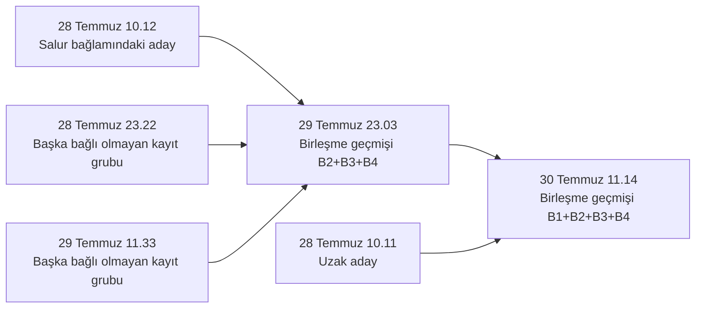

# Başlangıç geçmişini koruyan izleme provası — 19 Kasım 2026

Araştırmacı, Salur incelemesinden sonra A yönünü seçti. Sonraki grafik
birleşmelerinde önceki başlangıç hipotezlerini koruyan sınırlı yöntem
provası hazırlanacak. Bu karar gerçek yangın kimliği, güvenilir pozitif
küme, eğitim veya nihai birleştirme kabulü değil. Ana 24 saatlik yeni
orman/çalılık yangını hedefi ve bütün ilk hücreleri birlikte tutma
kararı korunuyor. [Karara temel vaka](SALUR_EVENT_CONTEXT_2026-11-19.md).

## Uygulanan davranış

16 Ekim'de hazırlanmış `event_lineage_diagnostic_v1` çekirdeği değiştirilmeden
yeniden kullanıldı. Bu çalışmanın yeni kapsamı, Salur'un bağımsız başlangıç
işaretine bağlı doğrulama komutu, zaman kesitleri ve aynı girdi üzerinde
ayar karşılaştırmasıdır. [Önceki çekirdek ve tanı](EVENT_LINEAGE_2026-10-16.md).

Çekirdek kayıtları zaman sırasıyla işler. Aynı kayıt zamanındaki bütün
tespitler tek parti olarak
değerlendirilir. Birbirine bağlanan ilk hücreler ortak aday kimliğinde
tutulur. Katalogdaki eşit zamanlar, fiziksel tutuşmaların aynı anda
olduğunun kanıtı sayılmaz.

1. Önceki bir bileşene bağlanmayan grup için başlangıç hipotezi oluşur.
   İlk zaman, bütün ilk tespitler ve bütün ilk hücreler kaydedilir.
2. Tek bir önceki bileşene bağlanan kayıtlar o geçmişi sürdürür.
3. Birden fazla önceki bileşen birleşirse ayrı bir birleşme düğümü
   oluşur. Ebeveynler ve bütün başlangıç hipotezleri saklanır.
4. Tespitlerin geldikleri anda bağlı oldukları düğüm ve başlangıç
   hipotezleri daha sonraki kayıtlarla yeniden yazılmaz.
5. Zaman boşluğundan sonra yeniden görünen grup başka bir başlangıç
   hipotezi üretebilir. Bu durum otomatik yeni yangın kabulü sağlamaz.
   Tespitlerin fiziksel olay üyeliği eksik olarak işaretlenir.

Başlangıç kimlikleri ayar ve ilk kaynak kimliklerinden, geçmiş durumu
kimlikleri ayar ve korunan başlangıç kimlikleri kümesinden deterministik
olarak türetilir. Oluşum zamanı ve ebeveynler ayrıca tutulur.
Gelecekteki üyeler başlangıç kimliğini
değiştirmez. Yeni çıktı dizinlerinde hash ile bağlı tablolar üretilir.
Mevcut kabul edilmiş atamalar veya bulut paketleri değiştirilmedi.

## Salur üzerinde ölçülen sonuç

Önceki hash ile bağlı tespit tabloları kullanıldı. Her senaryonun Salur
çevresine bağlı tam bileşeni ayrı çalıştırıldı. Son bileşenin üyelik
hash'i ve en eski zamanı önceki grafikle eşleşti. Yeni çekirdek bu
grafik bağlantısını değiştirmiyor; başlangıç geçmişini ayrıca koruyor.

Dokuz senaryoda şu dört kesimle **36 yeniden çalışma** yapıldı.
Her kesimde başlangıç, geçiş, geçmiş durumu ve tespitlerin geliş anındaki
alanları tam çalışmanın aynı tarihe kadarki kayıtlarıyla bire bir eşleşti.
Tespit tablosundaki son grafik üyeliği hash'i retrospektif bir alan olarak
ayrı tutuldu; geçmişin sabitliği karşılaştırmasına alınmadı.

- İlk yerel tespit anı, 28 Temmuz 2021 10.12 UTC.
- Hedef pencerenin sonu, 29 Temmuz 00.00 UTC.
- Bilinen sonraki kenardan bir nanosaniye önce.
- Kenarın oluştuğu 30 Temmuz 11.14 UTC.

En geniş ayarda Salur'a bağlı ilk tespit, 28 Temmuz **10.12**
başlangıç hipotezini korudu. İlk kümede aynı dört hücre var. Uzak
**10.11** tespiti ayrı başlangıç hipotezi olarak kaldı. 30 Temmuz
birleşme düğümü her iki geçmişi içeriyor. Tam kümenin en eski kayıt
alanı 10.11 olmaya devam ediyor; bu alan tek başına Salur başlangıç
etiketi olarak kullanılmıyor. Gerçek yangın kimliği çıkarılmadı.

Aşağıdaki şema 2 km / 72 saat ayarındaki kayıt geçmişi. B1–B4
grafik başlangıç hipotezleridir; dört gerçek yangın iddiası taşımaz.
Bütün saatler UTC.

## Aynı girdi üzerinde ayar duyarlılığı

Senaryoya göre değişen kaynak büyüklüklerini doğrudan karşılaştırmamak
için, en geniş bileşendeki aynı **5.304 tespit** dokuz ayarda ayrıca
işlendi. Her ayarda son bölümleme, sabit atama dosyasından bağımsız
okunan bölümlemeyle eşleşti.

| Mesafe / boşluk | Başlangıç hipotezi | Birleşme düğümü | Son bağlı bileşen |
|---|---:|---:|---:|
| 500 m / 24 saat | 426 | 66 | 75 |
| 500 m / 48 saat | 411 | 65 | 65 |
| 500 m / 72 saat | 405 | 65 | 60 |
| 1 km / 24 saat | 18 | 5 | 8 |
| 1 km / 48 saat | 17 | 5 | 7 |
| 1 km / 72 saat | 17 | 6 | 6 |
| 2 km / 24 saat | 4 | 1 | 2 |
| 2 km / 48 saat | 4 | 1 | 2 |
| 2 km / 72 saat | 4 | 2 | 1 |

Bu sayılar gerçek yangın veya bağımsız olay sayıları değil. Aynı
5.304 kayıt, geçmişte en geniş ayarda bağlanmış bir kümeden seçildi;
rastgele dört il örneklemi değil. Düşük hipotez sayısı başarı veya
daha doğru gruplama kanıtı sağlamıyor. Fazla bölme ve fazla birleştirme
ayrı incelenmeli. Bu tabloda üretim ayarı seçilmedi.

## Kontroller

Mevcut çekirdeğin 15 testi, 11 yeni zaman kesiti testi ve pencere
bağlamının 9 testi birlikte çalıştırıldı. **35 test**, Ruff ve biçim
kontrolü geçti. Kontroller
sonraki köprü, eşit zamanlı kayıtlar, değişmeyen geçmiş kimlikleri,
sürme ve yeniden görünme, tam boşluk sınırı ve bir nanosaniye sonrası,
kapsam reddi ve bağımsız küçük grafik bölümlemelerini içeriyor.

Küçük grafiklerde bölümleme, uzamsal indeks ve birleşim algoritmasını
kullanmayan tam çift uzaklığı/derinlik taramasıyla karşılaştırıldı.
Gerçek Salur çıktılarının hash, şema, boş hedef, ebeveyn ve geçmiş
kontrolleri ayrıca geri okundu. 2024/2025 analizi yapılmadı. Model
öğrenilmedi. Gözlem `unknown`, pozitif/negatif etiket izinleri kapalı.

Komut `python scripts/quality/review_salur_lineage.py`.
Son makbuz
`outputs/reports/dataset/salur_lineage_validation_v1/20261118T232816Z_7f270016/readback.json`.
SHA-256 `4455434aa2c4f3d10f87a9b0e46442453949e908eab29beb8cebcc75a5f75db2`.
UTC klasör tarihi 18 Kasım 23.28, Türkiye çalışma tarihi 19 Kasım.

Kod kökeni kontrolünde ilk yerel taslak ayrı saklandı. Nihai prova,
16 Ekim çekirdeği ve önceki test dosyası başlangıçtaki Git sürümüyle
bire bir korunarak yürütüldü. Ön taslak sonuçları nihai kabul raporu
yerine kullanılmadı. Taslak kaynakları
`outputs/reports/dataset/lineage_draft_preservation_v1/20261118T232202Z_cc671778/`
altında korunuyor. Yeni doğrulama komutu ve 11 ek test ayrı dosyalarda.

## Açık kalan konu ve sonraki adım

Başlangıç bilgisini koruma davranışı uygulandı ve sınırlı provada
sınandı. Hangi başlangıç hipotezinin gerçek yeni yangın sayılacağı,
aynı ilk zamandaki hücrelerin kaynakla eşleşmesi, örtü ve konum
belirsizliği henüz kabul edilmiş değil. Genel adayların parçalanması,
süren yangının gözlem boşluğundan sonra yeniden görünmesi ve bağımsız
değerlendirme desteği açık.

Sonraki karşılaştırma, mevcut Anamur ve Menderes kaynaklarında aynı
geçmiş korumasını sınamak ve kaynakla desteklenen başlangıç ile
yayılma/yeniden görünme adaylarını ayrı incelemek. Tek Salur provasıyla
dört il için bilimsel yöntem veya pozitif etiket kabulü yapılmayacak.
Birinci aşama sürüyor.
